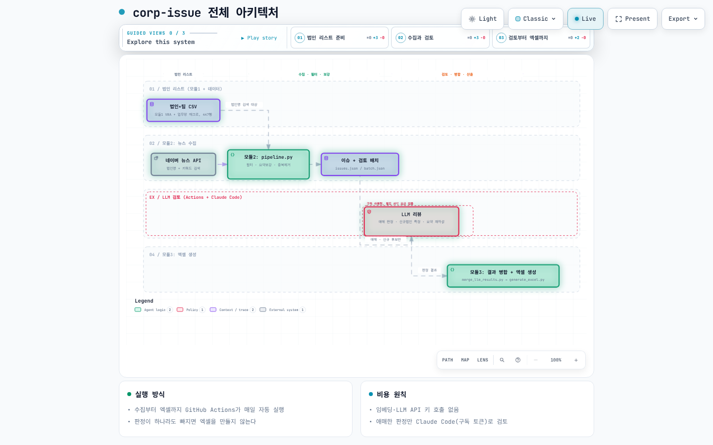

# 법인 뉴스 이슈 트래커

**미팅 전에 봐야 할 법인 뉴스를, 매일 아침 팀별 엑셀 한 파일로.**

뉴스 수집부터 선별, 요약, 영업 기회 분류까지 자동화한 법인 영업 지원 도구입니다. 담당자는 매일 아침 엑셀 하나만 열면 됩니다.

## 핵심 기능

- **365일 수집** · 주말·공휴일 뉴스까지 수집해 다음 영업일에 한 파일로 제공
- **신규 법인 발굴** · 관리 법인은 법인명으로, 신규 후보는 영업 키워드로 탐색
- **노이즈 제거** · 동명 법인, 애널리스트 코멘트, 단순 행사 기사 필터링과 중복 기사 통합
- **한 줄 요약** · `[법인명] + 핵심 사실 + 수치` 형식으로 정리
- **영업시그널 태깅** · 기사별로 제안 가능한 상품·솔루션 분류

## 영업시그널

| 영업시그널 | 포착 이슈 |
|---|---|
| 여유자금 활용 제안(펀드/랩/신탁) | 지분·자산 매각, 사업 철수, 특별배당 |
| 조달 니즈 발생 | 유상증자, 회사채·전환사채, 투자유치, M&A |
| 파생결합상품(ELB/DLB) | ELB·DLB, 구조화상품, 원금보장형 |
| 담보대출/유동성 | 주식담보대출, 최대주주 지분 변동, 자사주 취득·처분 |
| FX 솔루션 | 환헤지, 해외투자·수출 확대, 외화 조달 |
| 퇴직연금 솔루션 | 퇴직연금 사업자 선정·도입, DB·DC형, IRP |
| 대체투자/해외채권 중개 | 대체투자, PEF 출자, 블라인드펀드, 해외채권 투자 |
| 신사업·제휴(콜라보) | 신사업 진출, 디지털 전환, 해외 파트너십, 핀테크 제휴 |

## 받아보는 엑셀

- **파일** · 날짜별 1개, 연휴 다음 첫 영업일에는 기간 통합본도 (`이슈트래커(261009~261012).xlsx`)
- **시트** · `신규법인`, `1팀`~`6팀`
- **항목** · 법인명, 키워드, 영업시그널, 이슈요약, 원문링크
- **정렬** · 최신 이슈 법인 우선
- **편의 기능** · 헤더 고정, 자동 필터, 원문 하이퍼링크

## 동작 방식

1. **법인 목록 추출** · 업무망 엑셀용 VBA 자동 생성
2. **뉴스 수집** · 네이버 뉴스 법인명·키워드 검색, 선별과 중복 제거
3. **LLM 검토** · 애매한 기사와 신규 후보 판정, 요약 정리
4. **엑셀 생성** · 신규법인·팀별 시트로 정리

## 시작하기

수집, LLM 검토, 엑셀 생성은 GitHub Actions가 매일 자동으로 처리합니다. 코드는 이 공개 저장소에, 법인 목록과 결과(JSON, 엑셀)는 비공개 데이터 저장소에 있습니다. 엑셀은 데이터 저장소의 `outputs/<YYYY년 M월>/`에 커밋됩니다. 구성은 [docs/public-private-setup.md](docs/public-private-setup.md)를 봅니다.

- **매일 자동** · **모듈2 - 뉴스 수집 파이프라인**이 끝나면 **모듈2 - LLM 배치 검토 (Claude Code)**가 이어서 돌아 검토하고 엑셀을 만듭니다. 연휴 다음 첫 영업일에는 연휴 합본도 함께 만듭니다.
- **다시 만들기** · Actions에서 **모듈2 - LLM 배치 검토**를 날짜와 함께 실행합니다. Claude Code에서는 `/make-excel 2026-09-23`이 같은 일을 합니다.
- **엑셀만 다시** · 검토가 끝난 날짜는 **이슈트래커 엑셀 생성**에 날짜(합본은 `2026-10-09~2026-10-12`)를 넣습니다.

에이전트 작업 지침은 [AGENTS.md](AGENTS.md)에 있습니다.

## 더 알아보기

| 주제 | 문서 |
|---|---|
| 법인·팀 목록 추출 | [모듈 1: VBA 코드 생성](module1_vba_generator/README.md) |
| 뉴스 수집과 선별 | [모듈 2: 뉴스 수집과 선별](module2_news_pipeline/README.md) |
| 기사 검토와 결과 병합 | [LLM 검토와 결과 병합](module2_news_pipeline/llm_review/README.md) |
| 엑셀 생성 | [모듈 3: 엑셀 생성](module3_excel_generator/README.md) |
| 전체 기능 명세 | [기능 명세](docs/spec.md) |
